<table width="500%">
<tr>
  <td width="40%" align="center" valign="middle">
    
  </td>

  <td width="60%" align="center" valign="middle" nowrap>
    
      
    
  </td>
</tr>
</table>
## Về mình

<table>
<tr>

<td width="58%" valign="top">

Mình tên là Hào, thích tìm hiểu xem phần mềm thật sự hoạt động như thế nào ở tầng thấp nhất.

Phần lớn thời gian mình dành cho **reverse engineering**, **binary analysis** và **system internals**. Mình học chủ yếu bằng cách thực hành (*learning by doing*).

Mình chưa đủ giỏi để tạo ra điều gì lớn, nhưng mục tiêu hiện tại là **hoàn thành những project nhỏ và tiếp tục tiến bộ từng ngày**. Đặc biệt, mình rất thích **research (nghiên cứu)** mình thực sự muốn làm một tiến sĩ về kỹ thuật máy tính dưới lớp **phần mềm (software)**, **phần cứng (hardware)** lẫn **an ninh máy tính cấp thấp (cyber security low-level)**, chính vì thế mình luôn đào sâu mọi ngóc ngách của chương học liên quan và luôn đặt câu hỏi vì sao cho mọi thắc mắc mình ko hiểu.

</td>

<td width="82%" align="center" valign="top">
<kbd>

   

</kbd>
</td>

</tr>
</table>

 

## Những gì mình thường làm việc cùng

<table width="100%">
<tr>
<td width="55%" valign="top">

- **Reverse Engineering**  
- **Binary Analysis**
- **Low-level Programming** — C, Assembly  
- **Linux Internals & System Programming**  
- **Debugging & Vulnerability Research**

> mọi thứ vẫn đang trong quá trình học hỏi

</td>
<td width="45%" align="center" valign="middle">
<kbd>

<kbd>
</td>
</tr>
</table>

 

     
*Bạn nói 1+1=2, tôi nói 1+1=10. Cả hai thằng đều đúng nhưng cả hai thằng đều sai, tôi ko nhìn một trong hai, tôi nhìn hệ cơ số*

 
     
*(Trần Quang Hào)*

 
